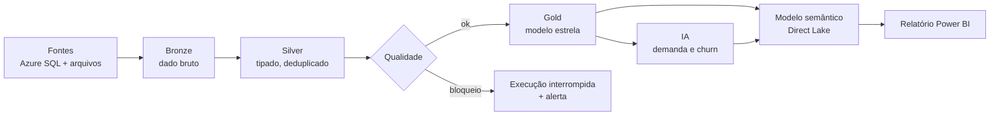

<div align="center">

# Fabric Data & IA Platform

**Plataforma de referência de dados e IA sobre Microsoft Fabric**
Ingestão, arquitetura medalhão, qualidade, governança, modelos de IA, Power BI em Direct Lake, orquestração e CI/CD.


[Cenário](#cenário) · [Arquitetura](#arquitetura) · [Pré-requisitos](#pré-requisitos) · [Estrutura](#estrutura-do-repositório) · [Execução](#passos-de-execução-ponta-a-ponta) · [Documentação](#documentação)

</div>

---

## Cenário

Rede varejista **fictícia** com vendas, clientes, produtos, lojas e estoque. Todos os dados são sintéticos: e-mails em domínios de exemplo, documentos com dígitos de controle inválidos e telefones em faixa fictícia.

| Pilar | O que entrega |
|---|---|
| **Fontes** | Azure SQL Database (clientes, produtos, lojas, vendas) e arquivos CSV/Parquet de estoque em armazenamento de objetos. |
| **Camadas** | Bronze (dado bruto + metadados), Silver (tipos, datas ISO 8601, deduplicação, quarentena) e Gold (modelo estrela com `dim_cliente` SCD2, fatos e agregações). |
| **Qualidade** | Regras em YAML; falha em regra bloqueante interrompe a promoção para a Gold. |
| **IA** | Previsão de demanda (regressão) e risco de churn (classificação), com MLflow e promoção só quando o candidato supera a versão em produção. |
| **Consumo** | Modelo semântico Direct Lake e relatório Power BI de cinco páginas, com RLS por loja e mascaramento dinâmico no Warehouse. |
| **Operação** | Pipeline mestre diário, alertas de falha, auditoria, painel de monitoramento e CI/CD em três ambientes (dev, test, prod). |

## Arquitetura



Os três diagramas completos (contexto, fluxo medalhão e implantação) estão em [`docs/diagramas.md`](docs/diagramas.md).

## Pré-requisitos

### Ferramentas e versões mínimas

| Ferramenta | Versão mínima | Uso |
|---|---|---|
| Python | 3.11 | Biblioteca `platform_lib`, scripts `infra/` e testes |
| pip | 23.0 | Instalação das dependências |
| Java (JDK) | 17 | PySpark local nos testes de integração (versão usada no CI) |
| Git | 2.40 | Controle de versão e fluxo por pull request |
| Azure CLI | 2.50 | Login, Key Vault e capacidade (`az login`) |
| Power BI Desktop | Versão recente com suporte a PBIP, PBIR e TMDL | Abrir `powerbi/fdai.pbip` |
| gitleaks | 8.18.4 | Varredura de segredos (mesma versão do CI) |

> [!NOTE]
> Dependências Python: `pip install -e ".[dev]"` (testes e lint) e, para os modelos, `pip install -e ".[ml]"` (MLflow, LightGBM, scikit-learn, NumPy). Os mínimos de pip, Git, Azure CLI e Power BI Desktop são recomendações do projeto e não são impostos pelo código.

### Permissões necessárias no Fabric e no Azure

| Onde | Permissão |
|---|---|
| **Fabric (tenant)** | "Service principals can use Fabric APIs" habilitada para o grupo do service principal. |
| **Capacidade Fabric** | Uma capacidade (SKU F) por ambiente atribuída ao workspace, ver [`docs/capacidade-e-custos.md`](docs/capacidade-e-custos.md). |
| **Provisionamento e deploy** | Função **Admin** ou **Member** do service principal nos workspaces `fdai-dev`, `fdai-test` e `fdai-prod`. |
| **Pessoas** | Admin (administrador), Member (engenheiro), Contributor (analista) e Viewer (consumidor), mapeadas a grupos do Entra ID em `infra/governance/roles_matrix.json`. |
| **Key Vault** | `Key Vault Secrets User` para o service principal e para as conexões de ingestão. |
| **Capacidade no Azure** | Contributor restrito ao recurso da capacidade de dev e test, para `infra/capacity.py`. |
| **Purview** | Curador de dados e permissão de varredura sobre o workspace Fabric. |
| **GitHub** | Secrets `AZURE_CLIENT_ID_TEST`, `AZURE_CLIENT_ID_PROD`, `AZURE_TENANT_ID`, `AZURE_SUBSCRIPTION_ID` e `DEPLOY_WEBHOOK_URL`; environment `prod` com pelo menos 1 aprovador. |

## Estrutura do repositório

| Item | Descrição |
|---|---|
| `.github/` | Workflows do Pipeline_CICD: validação de PR, deploy em test e prod e varredura de segredos. |
| `.kiro/` | Especificação do projeto (requisitos, design e tarefas) usada para guiar o desenvolvimento. |
| `config/` | Entidades de ingestão, regras de qualidade em YAML, esquema Gold e DDL de configuração. |
| `docs/` | Diagramas Mermaid, ADRs, runbook, capacidade e custos, dicionário de dados e model cards. |
| `infra/` | Provisionamento idempotente, deploy, pausa e retomada de capacidade, governança e geradores de DDL. |
| `notebooks/` | Notebooks Fabric finos (Bronze, Silver, Gold, qualidade, IA, reexecução) que chamam `platform_lib`. |
| `pipelines/` | Definições dos pipelines de ingestão (ADF e Fabric Data Factory) e do pipeline mestre. |
| `powerbi/` | Projetos PBIP/TMDL do modelo semântico Direct Lake, do relatório e do painel de monitoramento. |
| `src/` | Pacote `platform_lib` com a lógica de negócio em Python puro, testável sem Spark nem Fabric. |
| `tests/` | Testes unitários, de propriedade (Hypothesis) e de integração. |

Arquivos de primeiro nível: `.env.example` (variáveis sem segredos), `.gitignore`, `pyproject.toml`.

## Passos de execução ponta a ponta

1. **Clonar e preparar o Python.** Clone o repositório, crie e ative um ambiente virtual e instale as dependências:
   ```bash
   python -m venv .venv
   pip install -e ".[dev,ml]"
   ```
2. **Configurar variáveis.** Copie `.env.example` para `.env` (ignorado pelo Git) e preencha os placeholders. Segredos ficam no Key Vault, nunca no `.env` versionado.
3. **Validar localmente.** Todos os testes devem passar antes de seguir:
   ```bash
   ruff check .
   python -m pytest
   ```
4. **Autenticar.** Faça `az login` e exporte `FABRIC_TOKEN` com o token do service principal (nunca em arquivo versionado).
5. **Provisionar os ambientes.** Cria, por ambiente, 1 workspace, 3 Lakehouses (bronze, silver, gold) e 1 Warehouse. É idempotente: reexecutar só cria o que falta.
   ```bash
   python -m infra.provision --envs dev test prod
   ```
6. **Gerar DDL e dicionário.** Aplique o DDL do Gold e o de auditoria (`pipelines/master/sql/ddl_audit.sql`) no Warehouse, e o de configuração (`config/ddl_ingestao.sql`).
   ```bash
   python -m infra.gen_gold_ddl --dialect delta
   python -m infra.gen_gold_ddl --dialect tsql
   python -m infra.gen_data_dictionary
   python -m infra.governance.gen_masking
   ```
7. **Gerar e carregar dados sintéticos.** Use `--env-file` para os destinos. A carga é idempotente.
   ```bash
   python -m platform_lib.synth --seed 42 --n-customers 1000 --n-products 200 --n-stores 20 --start 2023-01-01 --end 2024-12-31
   ```
8. **Publicar os itens.** Faça deploy de pipelines, notebooks e modelo semântico em `dev` pelo fluxo de PR e use `python -m infra.deploy deploy --env test`. O CI executa test e prod; prod exige aprovação manual.
9. **Configurar governança.** Aplique as definições de `infra/governance/` (coleções, regras de classificação e varredura do Purview, mascaramento e tabelas de segurança) e a RLS do modelo semântico.
10. **Executar o pipeline mestre.** Dispare `pl_master` no workspace. Ele roda `ingestao`, `silver`, `qualidade`, `gold`, `ia` e `semantico` em sequência. Em falha, siga [`docs/runbook.md`](docs/runbook.md).
11. **Conferir a execução.** A consulta abaixo deve mostrar as seis etapas com status `sucesso`, e `dq.resultados` não deve ter regra `blocking` com violações.
    ```sql
    SELECT * FROM audit.execucoes_etapas WHERE run_id = '<run_id>';
    ```
12. **Validar as tabelas Gold.** No Warehouse, confirme que existem `dim_cliente`, `dim_produto`, `dim_loja`, `dim_calendario`, `fato_vendas`, `agg_vendas_dia`, `fato_estoque`, `features_demanda`, `features_churn`, `previsao_demanda` e `previsao_churn`. Confirme também que `SELECT COUNT(*) FROM fato_vendas` é igual à contagem de vendas válidas na Silver, que `dim_cliente` tem no máximo uma linha com `vigente = 1` por `cliente_id` e que `python -m infra.gen_data_dictionary --check` não aponta diferenças.
13. **Abrir o relatório.** Abra `powerbi/fdai.pbip`, aponte para o workspace e confira as cinco páginas e o cartão "Última atualização".

## Documentação

| Documento | Conteúdo |
|---|---|
| [`docs/diagramas.md`](docs/diagramas.md) | Diagramas de contexto, fluxo medalhão e implantação. |
| [`docs/adr/`](docs/adr) | Decisões de arquitetura (ADRs). |
| [`docs/runbook.md`](docs/runbook.md) | Procedimentos de operação e resposta a falhas. |
| [`docs/capacidade-e-custos.md`](docs/capacidade-e-custos.md) | Dimensionamento, estimativa de custo e pausa/retomada de capacidade. |
| [`docs/data-dictionary.md`](docs/data-dictionary.md) | Dicionário de dados da Gold. |
| [`docs/model_cards/`](docs/model_cards) | Model cards dos modelos de demanda e churn. |
| [`docs/git-workflow.md`](docs/git-workflow.md) | Fluxo de trabalho Git e proteção de branch. |

## Fluxo de trabalho Git

Alterações entram por branch de trabalho (`feature/`, `fix/`, `chore/`, `docs/`, `test/`) e pull request revisado. Nunca faça commit direto na branch base em repositórios de terceiros. Detalhes em [`docs/git-workflow.md`](docs/git-workflow.md).