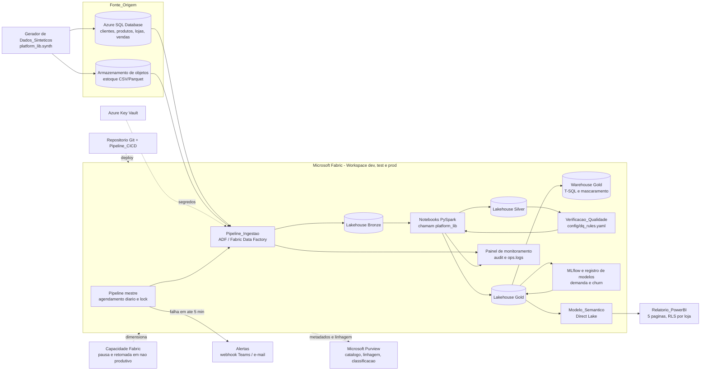
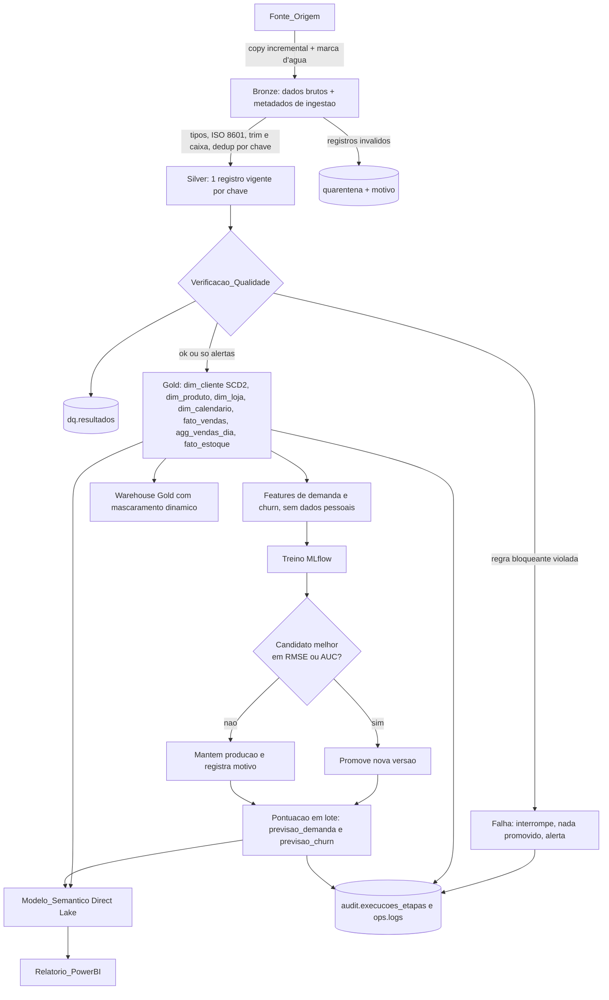
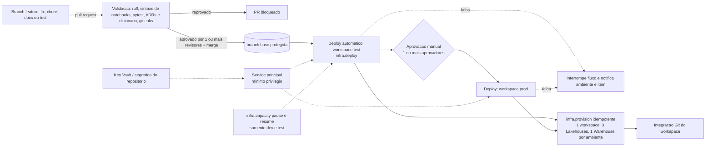

# Diagramas de arquitetura

Três diagramas em Mermaid (Req. 11.2): contexto, fluxo de dados medalhão e implantação. Adaptados de `.kiro/specs/fabric-data-ai-platform/design.md`. Cada rótulo está entre aspas para evitar erro de sintaxe com parênteses e símbolos.

## 1. Contexto

Componentes e integrações externas: fontes, gerador sintético, Key Vault, ingestão, camadas, IA, modelo semântico, relatório, governança (Purview), observabilidade e alertas, CI/CD e capacidade.

## 2. Fluxo de dados medalhão

Fluxo da fonte ao relatório: marca d'água, Bronze, Silver, quarentena, qualidade, Gold (SCD2), features, treino, promoção de modelo, pontuação e modelo semântico.

## 3. Implantação e CI/CD

Do branch de trabalho até produção, com validação, aprovação manual, falha, service principal, segredos, provisionamento e pausa de capacidade.

